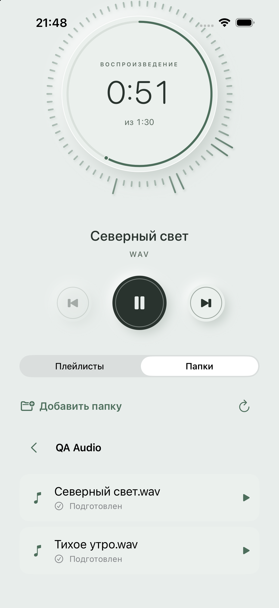

# Плейлисты / Папки — реализация и проверки

Дата: 1 ноября 2026 года. Архитектурный этап зафиксирован отдельным коммитом `e09052b` (`Architecture refactoring`); фича выполнена после него. Приложение остаётся `.xcodeproj` с локальным SwiftPM-пакетом.

## Поведение

- Переключатель «Плейлисты / Папки» меняет только область библиотеки; текущая музыка продолжает играть.
- Сохраняются только выбранные корни: UUID, имя, bookmark и порядок. Подпапки, путь просмотра и очередь не восстанавливаются при перезапуске.
- Открытие каталога читает только непосредственные папки и поддерживаемые аудиофайлы. Скрытые элементы, пакеты и символические ссылки исключаются. Сначала папки, затем файлы с естественной сортировкой.
- Нажатие файла фиксирует очередь аудиофайлов текущего уровня. Next/Previous, shuffle и repeat работают в её пределах; окончания каталога недостаточно для перехода в плейлист или соседнюю папку.
- Предварительное копирование идёт последовательно в фоне. Выбранный трек использует отдельную очередь подготовки. Аудиодвижок получает полностью готовый локальный файл из временного кеша.
- Кеш проверяет размер/дату версии и целостность копии, публикует её атомарно. Мягкий бюджет — 512 MiB; закреплённые файлы и длинный выбранный трек могут временно превысить его. Незакреплённые старые копии вытесняются. Кеш не является обещанием офлайн-доступа.
- Пауза, новый выбор и удаление корня инвалидируют старую подготовку; поздний результат не начинает воспроизведение. Lease текущей копии освобождается только после остановки чтения аудиодвижком.
- Удаление корня забывает ссылку и останавливает связанную очередь; исходные файлы не удаляются. Экспорт плейлистов не включает корни и временные очереди.

Прежний рекурсивный импорт папки **в плейлист** сохранён как отдельная операция. Перестановка плейлистов из исходного анализа не входит в текущий запрос и не добавлялась.

## Архитектура

`PlayerApplication` создаёт зависимости и связывает `PlayerFeature` с `FolderFeature` через UI-slot и типизированный результат выбора. Фичи не импортируют друг друга или инфраструктуру. `FolderDomain` содержит значения и контракты; `PlayerInfrastructure` — отдельное JSON-хранилище корней, file coordination, кеш и аудиодвижок. Схема SwiftData плейлистов не расширялась.

Для внешнего I/O использованы [доступ к каталогам через picker](https://developer.apple.com/documentation/uikit/providing-access-to-directories), [рекомендации Apple по файловому I/O](https://developer.apple.com/documentation/foundation/improving-performance-and-stability-when-accessing-the-file-system) и [контракт отмены NSFileCoordinator](https://developer.apple.com/documentation/foundation/nsfilecoordinator/cancel()).

Контекст и карта модулей: [ATPlayerKit README](../../SRC/ATPlayer/LocalPackages/ATPlayerKit/README.md).

## Проверки

Расчёт из записей XCTest выполнен Python:

```text
passed / total = 42 / 42; failures = 0
```

- Сборка приложения и widget: `xcodebuild -project SRC/ATPlayer/ATPlayer.xcodeproj -scheme ATPlayer -destination 'generic/platform=iOS Simulator' -derivedDataPath /tmp/ATPlayerArchitectureDerived CODE_SIGNING_ALLOWED=NO build`.
- XCTest из `SRC/ATPlayer/LocalPackages/ATPlayerKit`: `xcodebuild -scheme ATPlayerKit-Package -destination 'platform=iOS Simulator,id=A0EA97FA-8776-4762-96D7-CEA800200E5A' -derivedDataPath /tmp/ATPlayerPackageDerived -resultBundlePath /tmp/ATPlayerFoldersTests-final.xcresult CODE_SIGNING_ALLOWED=NO test` — TEST SUCCEEDED.
- Проверены старая база, текущая очередь и режимы, отмена/поздние ответы, отсутствие рекурсии, стабильные ID, сортировка, корни после перезапуска, безопасный refresh bookmark, ошибки записи, кеш и защита lease. Реальный AVAudioEngine воспроизводит копию после исчезновения исходного файла.
- В Device Hub / iOS 26.5 выполнен путь: «Папки» → системный picker → QA Audio → подготовка → воспроизведение → «Плейлисты» → «Папки». Музыка и позиция сохранялись. После перезапуска виден сохранённый корень без прежнего открытого дерева; повторное открытие загружает список заново.
- В фактическом JSON QA-приложения только `version`, `sources`, и поля корня `id`, `name`, `bookmark`, `order`. Файлы копий находятся в `tmp/ATPlayerFolderCache`.
- Проверка запрещённых импортов Python, `plutil -lint` проекта и `git diff --check` прошли. Предупреждение Thread Performance Checker об инверсии QoS устранено; в итоговом тестовом прогоне оно отсутствует. Предупреждение о пропуске AppIntents metadata относится к XCTest bundles без AppIntents.



## Ограничения доказательств

Реальные iCloud Drive, SMB и сторонние File Providers на физическом устройстве не проверялись. Реализация использует документированные security scopes и coordinated read, но поведение конкретного провайдера, сеть, Bluetooth/AirPlay, фон и экран блокировки на устройстве требуют отдельного прогона. Системный I/O, уже выполняющийся внутри accessor, не всегда можно немедленно прервать: UI перестаёт ждать по отмене/timeout, worker сохраняет владение ресурсами и удаляет поздний результат.

Публикация, App Store, push и изменение статуса отправленной версии не выполнялись.

TRACE:
- Skill: implementation-from-plan.
- Task folder: none; проект ATPlayer, артефакты в текущем каталоге.
- References read: folders-analysis.md; Development_Guide.md; delivery-pipeline.md; затронутые исходники и документация; Apple directory access/file coordination/I/O docs.
- Knowledge read: swift/_rules.md, swift/verification.md, ios/_rules.md, swift/patterns/common/_summary.md, swift/patterns/platform/_summary.md.
- Patterns/policies applied: Feature-First SwiftPM, явная DI, один владелец playback state, snapshot очереди, generation checks, scoped lifetime, атомарное сохранение, сохранение пользовательского xcuserstate.
- Verification: сборки, 42/42 XCTest, UI smoke на iOS 26.5, JSON/cache inspection, import graph, plist, diff-check.
- Residual risk: физические устройства и внешние провайдеры, перечисленные выше.
