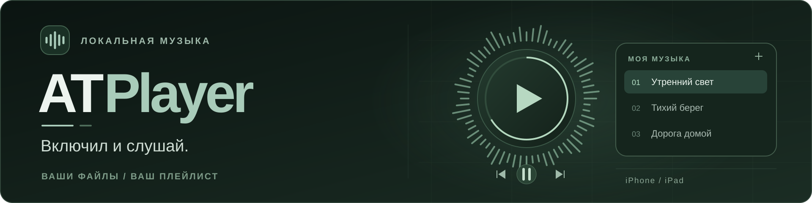
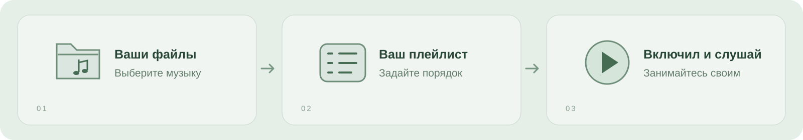

  

# ATPlayer

*[English](README.md)*

[Сайт приложения](https://andrey-torlopov.github.io/ATPlayer/) · [Website in English](https://andrey-torlopov.github.io/ATPlayer/en/)

## Зачем нужен этот плеер

Иногда музыка уже выбрана. Хочется собрать плейлист из своих файлов, включить воспроизведение и больше не отвлекаться на плеер.

ATPlayer — простой локальный аудиоплеер для iPhone и iPad. Ваши файлы, плейлист в нужном порядке и понятное управление. Без аккаунта, рекомендаций и стримингового каталога.

  

## Доступность

**Подготавливается версия 1.4.0 (сборка 6) со связанными регуляторами уровня и фона радиоэффекта; запись 12 выровнена по громкости. Смена треков обычная, без поиска станции. Текущие проверки и ограничения указаны в записи о релизе; прежний подписанный архив не содержит последних изменений.**

- iPhone и iPad с **iOS / iPadOS 26.0 и новее**.
- Интерфейс и документация доступны **на русском и английском языках**. Язык переключается кнопками **RU / EN** в настройках.
- Планируемый выпуск в App Store — **бесплатный, без встроенных покупок**.

Разработчики могут [запустить проект из исходников](docs/ru/development.md). Наличие тега в Git не означает, что Apple одобрила или опубликовала эту версию. Подробнее — в [статусе релиза и проверках](docs/ru/releases.md).

## Начать слушать

1. В пустом плейлисте нажмите **«Добавить музыку»** или откройте меню плейлиста **…** → **«Добавить треки»**.
2. Выберите свои аудиофайлы или папку в приложении «Файлы».
3. Нажмите на трек. Один раз расставьте музыку в нужном порядке — и слушайте.

Импорт в плейлист сохраняет ссылки на файлы и включает вложенные каталоги при выборе папки. Режим **«Папки»** сохраняет выбранные корни, позволяет переходить по одному уровню и воспроизводит аудио только этого уровня. Навигация и смена режима не прерывают текущий трек. Облачные и сетевые файлы подготавливаются во временном локальном кеше; это не гарантирует доступ без сети. [Быстрый старт →](docs/ru/quick-start.md)

## Что есть в приложении

| Для прослушивания | Для вашей музыки |
|---|---|
| Воспроизведение в фоне и управление с экрана блокировки | Файлы и рекурсивный импорт в плейлист; просмотр папок |
| Круговая перемотка и визуализация звука | Именованные плейлисты; перестановка плейлистов и треков |
| Live Activities на поддерживаемых устройствах | Удаление записей без удаления аудио |
| 10-полосный эквалайзер и предусиление | Экспорт сведений о плейлистах в JSON |
| Светлая и тёмная темы; интерфейс для iPhone и iPad | Локальное хранение плейлистов; без аккаунта |

Музыка в приложение не включена. Для воспроизведения файл должен быть доступен и поддерживаться системным аудиодекодером. JSON-экспорт содержит названия и пути, но не музыку и не резервную копию для восстановления медиатеки. [Возможности и ограничения →](docs/ru/features.md)

## Документация

- [Быстрый старт](docs/ru/quick-start.md)
- [Возможности и порядок воспроизведения](docs/ru/features.md)
- **[Где хранятся данные и когда нужен интернет](docs/ru/data-and-privacy.md)**
- [Разработка и архитектура](docs/ru/development.md)
- [RadioNoiseKit — отдельный SPM-пакет радиопомех](SRC/ATPlayer/LocalPackages/RadioNoiseKit/README.md)
- [NoiseDemo — лаборатория генератора для iPhone и iPad](SRC/NoiseDemo/README.md)
- [Статус релиза и проверки](docs/ru/releases.md)
- [Вся документация](docs/ru/index.md)

## Поддержка и конфиденциальность

[Руководство поддержки](SUPPORT.md) · [Политика конфиденциальности](PRIVACY.md) · [mail@torlopov.dev](mailto:mail@torlopov.dev)

ATPlayer не отправляет разработчику вашу медиатеку и историю прослушивания. Выбранные файлы из облачных хранилищ используют сервисы их поставщиков. Если вы решите написать в поддержку, текст письма и контактные данные используются для обработки обращения.

Разработчик — **Andrey Torlopov**.
