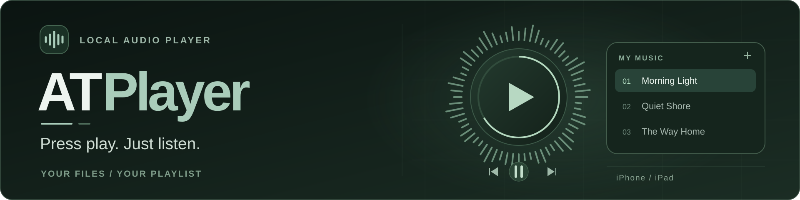
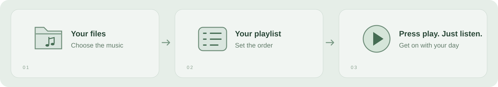

  

# ATPlayer

*[Русский](README-ru.md)*

[Website](https://andrey-torlopov.github.io/ATPlayer/en/) · [Сайт на русском](https://andrey-torlopov.github.io/ATPlayer/)

## Why this player exists

Sometimes you have already chosen the music. You want to put your files in a playlist, press play, and leave the player alone.

ATPlayer is a simple local audio player for iPhone and iPad. Your own files, an ordered playlist, and the controls you need to listen. No account, recommendations, or streaming catalog.

  

## Availability

**Version 1.4.0 (build 6) is in preparation with linked radio maximum/background controls and balanced noise from recording 12. Track changes use ordinary playback without station-search sounds. See the release record for current checks and limitations; the earlier signed archive does not include the latest changes.**

- iPhone and iPad with **iOS / iPadOS 26.0 or later**.
- The app interface and documentation are available **in Russian and English**. Select **RU / EN** in Settings.
- The planned App Store release is **free, without in-app purchases**.

Developers can [run the project from source](docs/en/development.md). A source tag does not mean that Apple has approved or published that version. See [release status and verification](docs/en/releases.md).

## Start listening

1. In an empty playlist, tap **«Добавить музыку»** (Add Music), or open the playlist's **…** menu → **«Добавить треки»** (Add Tracks).
2. Choose your audio files or a folder in Files.
3. Tap a track. Arrange the order once, then let the music play.

Playlist import keeps references to your files and includes subfolders when you select a folder. **«Папки»** (Folders) lets you save selected roots, browse one level at a time, and play only that level’s audio. Browsing and switching modes leave the active track playing. Cloud or network files are prepared in a temporary local cache; this is not a guarantee of offline availability. [Quick start →](docs/en/quick-start.md)

## What is included

| For listening | For your collection |
|---|---|
| Background playback and Lock Screen controls | Files and recursive playlist import; folder browsing |
| Circular seek control and audio visualization | Named playlists; playlist and track reordering |
| Live Activities on supported devices | Removing entries without deleting audio |
| 10-band equalizer and preamp | JSON export of playlist information |
| Light and dark appearance; iPhone and iPad layouts | Local playlist storage; no app account |

Music is not included. Playback depends on the selected file being accessible and supported by the system audio decoder. The JSON export contains names and paths, not music or a restorable library backup. [Features and limits →](docs/en/features.md)

## Documentation

- [Quick start](docs/en/quick-start.md)
- [Features and playback behavior](docs/en/features.md)
- **[Where data lives and when a connection is needed](docs/en/data-and-privacy.md)**
- [Development and architecture](docs/en/development.md)
- [RadioNoiseKit — standalone radio noise package](SRC/ATPlayer/LocalPackages/RadioNoiseKit/README.md)
- [NoiseDemo — generator playground for iPhone and iPad](SRC/NoiseDemo/README.md)
- [Release status and verification](docs/en/releases.md)
- [All documentation](docs/en/index.md)

## Support and privacy

[Support guide](SUPPORT.md) · [Privacy policy](PRIVACY.md) · [mail@torlopov.dev](mailto:mail@torlopov.dev)

ATPlayer does not send your library or listening history to the developer. Files selected from cloud providers use those providers' services. If you choose to email support, your message and contact details are used to handle the request.

Developed by **Andrey Torlopov**.
