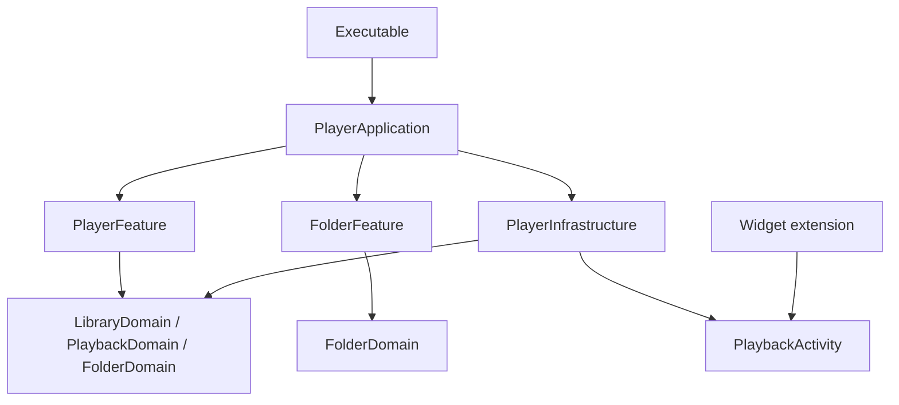

# Development and architecture

*[Русский](../ru/development.md)*

## Open the project

The repository contains a native SwiftUI application, a WidgetKit/ActivityKit extension, and the local **ATPlayerKit** SwiftPM package. There are no third-party package dependencies. The Feature-First refactoring and Folders mode described here are in the current source; they are not part of the submitted 1.0.2 (1) build. The current release preparation was built with **Xcode 27.2**. Supported deployment targets start at **iOS / iPadOS 26.2**.

```sh
git clone https://github.com/andrey-torlopov/ATPlayer.git
cd ATPlayer
open SRC/ATPlayer/ATPlayer.xcodeproj
```

Choose the shared **ATPlayer** scheme and an iPhone or iPad simulator, then Run. The current project declares Russian as its development language. English documentation does not imply an English app localization.

To make an unsigned simulator build from the repository root:

```sh
xcodebuild \
  -project SRC/ATPlayer/ATPlayer.xcodeproj \
  -scheme ATPlayer \
  -configuration Debug \
  -destination 'generic/platform=iOS Simulator' \
  -derivedDataPath .build/DerivedData \
  CODE_SIGNING_ALLOWED=NO \
  build
```

For installation on your own device, configure your own development team and provisioning for **both** the app and its extension. Their bundle identifiers must be unique to your account, and the extension's identifier must use the app's identifier as its prefix. The checked-in release configuration refers to the maintainer's distribution profiles; those profiles are not credentials supplied to repository users.

## Code map

The local package is at `SRC/ATPlayer/LocalPackages/ATPlayerKit/`. Its target dependencies are declared in `Package.swift`; the following package paths are relative to that directory.

| Location | Responsibility |
|---|---|
| `SRC/ATPlayer/ATPlayer/ATPlayerApp.swift` | Thin executable shell and process lifetime |
| `Sources/PlayerApplication/` | Composition root, concrete adapters, feature wiring, lifecycle and intent routing |
| `Sources/PlayerFeature/` | Playlist UI, playback state and common playback queue integration; V1 is the current UI |
| `Sources/FolderFeature/` | Independent folder browser state and UI, navigation and prefetch lifecycle |
| `Sources/LibraryDomain/`, `Sources/PlaybackDomain/`, `Sources/FolderDomain/` | Domain models and contracts without concrete storage or feature UI |
| `Sources/PlayerInfrastructure/` | SwiftData storage, file access, temporary cache, AVAudioEngine, Now Playing and Activity adapters |
| `Sources/PlaybackActivity/` | Shared ActivityKit attributes used by the app and extension |
| `Tests/` | Playback, folder browser, storage, file access/cache and legacy schema compatibility tests |
| `SRC/ATPlayer/ATPlayerWidgetExtension/` | Live Activity rendering and extension entry point |

`PlayerDesignVersion.current` in `Sources/PlayerFeature/Presentation/` selects V1. V0 views remain for comparison. New folder UI belongs to `FolderFeature`; neither UI feature imports the other or concrete infrastructure.

## Module boundaries and playback



`PlayerApplication` creates concrete services and connects the folder browser's typed selection to the shared playback owner. Dependencies are injected through domain contracts. Browsing and library mode are independent of the active audio session, so moving between folders does not replace the playing queue.

Playlist records keep the original SwiftData entity names and schema. The storage adapter maps them to domain objects; failed mutations roll back. Saved folder roots use `Application Support/ATPlayer/folder-sources.json` and do not extend the playlist database. Listings, navigation and folder queues remain in memory. JSON playlist export excludes folders.

In Folders mode, file I/O and coordinated copying run away from the UI actor. Playback reads a local cache lease held until the engine stops using it. Browser prefetch is sequential and cancellable; explicit playback has priority. The temporary cache uses a 512 MiB soft budget, can temporarily exceed it for pinned handoff files or an explicitly selected oversized recording, and evicts unused copies. It is not an offline guarantee. Playlist folder import retains its recursive behavior; folder browsing and playback never recurse.

## Verification boundaries

The package provides `PlayerInfrastructureTests`, `PlayerFeatureTests`, and `FolderFeatureTests`, with a separate `LegacyPlaylistFixture` target. Open `Package.swift` in Xcode and select **ATPlayerKit-Package** to run these tests on an installed iOS simulator. The app scheme remains **ATPlayer**. Tests cover a legacy store opened after module relocation, queue boundaries, cancellation and late results, root persistence, and local cache/file operations. Mock-provider and local-file tests do not verify real iCloud, SMB, third-party providers, audio routes, interruptions, or background playback; exercise those scenarios on a device and record its model and OS.

Before sending a change, check that adding files, relaunching, seeking, advancing tracks, editing a playlist, and leaving the app still behave as intended. Also verify switching library modes during playback, a current-level folder queue, forgetting an active root, and cloud/network preparation. Pay particular attention to unavailable files and cancelled imports. See [release verification](releases.md).

No repository-wide open-source license has been declared. Public source availability is not itself a license grant.

---

[Documentation](index.md) · [README](../../README.md)
