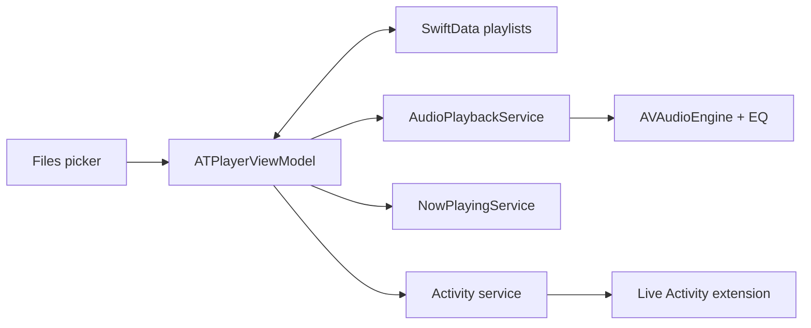

# Development and architecture

*[Русский](../ru/development.md)*

## Open the project

The repository contains a native SwiftUI application, a WidgetKit/ActivityKit extension, and no third-party package dependencies in the Xcode project. The current release preparation was built with **Xcode 27.2**. Supported deployment targets start at **iOS / iPadOS 26.2**.

```sh
git clone https://github.com/andrey-torlopov/ATPlayer.git
cd ATPlayer
open SRC/ATPlayer/ATPlayer.xcodeproj
```

Choose the shared **ATPlayer** scheme and an iPhone or iPad simulator, then Run. The current project declares Russian as its development language. English documentation does not imply an English app localization.

To make an unsigned simulator build from the repository root:

```sh
xcodebuild \
  -project SRC/ATPlayer/ATPlayer.xcodeproj \
  -scheme ATPlayer \
  -configuration Debug \
  -destination 'generic/platform=iOS Simulator' \
  -derivedDataPath .build/DerivedData \
  CODE_SIGNING_ALLOWED=NO \
  build
```

For installation on your own device, configure your own development team and provisioning for **both** the app and its extension. Their bundle identifiers must be unique to your account, and the extension's identifier must use the app's identifier as its prefix. The checked-in release configuration refers to the maintainer's distribution profiles; those profiles are not credentials supplied to repository users.

## Code map

| Location | Responsibility |
|---|---|
| `SRC/ATPlayer/ATPlayer/ATPlayerApp.swift` | SwiftData container and shared view-model lifetime |
| `SRC/ATPlayer/ATPlayer/ViewModels/ATPlayerViewModel.swift` | Import, file bookmarks, playlist actions, playback sequence, presentation coordination |
| `SRC/ATPlayer/ATPlayer/Services/AudioPlaybackService.swift` | Audio session, AVAudioEngine playback, equalizer, spectrum |
| `SRC/ATPlayer/ATPlayer/Services/PlaylistStorageService.swift` | SwiftData playlist and track mutations |
| `SRC/ATPlayer/ATPlayer/Services/NowPlayingService.swift` | System media metadata and remote commands |
| `SRC/ATPlayer/ATPlayer/LiveActivity/` | Activity state, lifecycle, and app playback intents |
| `SRC/ATPlayer/ATPlayer/Views/Components/V1/` | Current UI, themes, playlist editor, and settings |
| `SRC/ATPlayer/ATPlayerWidgetExtension/` | Live Activity rendering and widget extension entry point |

`PlayerDesignVersion.current` selects V1. The V0 views remain in the tree for comparison and are not the current interface.

## How playback fits together



The view model owns the playback service and keeps Now Playing and Live Activities synchronized with it. Audio files are opened through stored access bookmarks. Playlist edits are saved through the storage service; the store rolls back failed mutations.

## Verification boundaries

The shared scheme does not currently contain an XCTest target. A successful build alone does not verify file-provider behavior, audio routes, interruptions, or background playback. For a change in these areas, exercise the relevant scenario on a device and state the device and OS used.

Before sending a change, check that adding files, relaunching, seeking, advancing tracks, editing a playlist, and leaving the app still behave as intended. Pay particular attention to unavailable files and cancelled imports. See [release verification](releases.md).

No repository-wide open-source license has been declared. Public source availability is not itself a license grant.

---

[Documentation](index.md) · [README](../../README.md)
