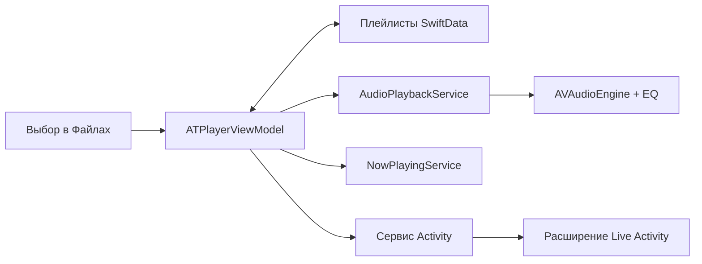

# Разработка и архитектура

*[English](../en/development.md)*

## Открыть проект

В репозитории находятся нативное SwiftUI-приложение и расширение WidgetKit/ActivityKit. Сторонних пакетных зависимостей в проекте Xcode нет. Текущая подготовка релиза собрана в **Xcode 27.2**. Минимальная версия системы — **iOS / iPadOS 26.2**.

```sh
git clone https://github.com/andrey-torlopov/ATPlayer.git
cd ATPlayer
open SRC/ATPlayer/ATPlayer.xcodeproj
```

Выберите общую схему **ATPlayer**, симулятор iPhone или iPad и выполните Run. Основной язык проекта — русский. Английская документация не означает наличия английской локализации приложения.

Команда сборки для симулятора без подписи из корня репозитория:

```sh
xcodebuild \
  -project SRC/ATPlayer/ATPlayer.xcodeproj \
  -scheme ATPlayer \
  -configuration Debug \
  -destination 'generic/platform=iOS Simulator' \
  -derivedDataPath .build/DerivedData \
  CODE_SIGNING_ALLOWED=NO \
  build
```

Для установки на своё устройство настройте собственную команду разработчика и provisioning **для приложения и расширения**. Bundle identifiers должны быть уникальными в вашем аккаунте; идентификатор расширения должен начинаться с идентификатора приложения. Release-конфигурация в репозитории ссылается на distribution-профили автора; эти профили не предоставляют пользователям репозитория доступ к его аккаунту.

## Карта кода

| Расположение | Ответственность |
|---|---|
| `SRC/ATPlayer/ATPlayer/ATPlayerApp.swift` | Контейнер SwiftData и время жизни общей view model |
| `SRC/ATPlayer/ATPlayer/ViewModels/ATPlayerViewModel.swift` | Импорт, закладки файлов, плейлисты, последовательность воспроизведения, системное отображение |
| `SRC/ATPlayer/ATPlayer/Services/AudioPlaybackService.swift` | Аудиосессия, воспроизведение AVAudioEngine, эквалайзер, спектр |
| `SRC/ATPlayer/ATPlayer/Services/PlaylistStorageService.swift` | Изменения плейлистов и треков в SwiftData |
| `SRC/ATPlayer/ATPlayer/Services/NowPlayingService.swift` | Системные метаданные и команды воспроизведения |
| `SRC/ATPlayer/ATPlayer/LiveActivity/` | Состояние, жизненный цикл и App Intents для воспроизведения |
| `SRC/ATPlayer/ATPlayer/Views/Components/V1/` | Текущий интерфейс, темы, редактор плейлиста и настройки |
| `SRC/ATPlayer/ATPlayerWidgetExtension/` | Отображение Live Activity и точка входа расширения |

`PlayerDesignVersion.current` выбирает V1. Представления V0 сохранены для сравнения и не являются текущим интерфейсом.

## Как устроено воспроизведение



View model владеет сервисом воспроизведения и синхронизирует с ним Now Playing и Live Activities. Аудиофайлы открываются через сохранённые закладки доступа. Изменения плейлистов проходят через сервис хранения; неудачные операции откатываются в хранилище.

## Границы проверки

В общей схеме сейчас нет XCTest target. Успешная сборка сама по себе не проверяет поставщиков файлов, аудиомаршруты, прерывания и фоновое воспроизведение. При изменении этих областей проверьте соответствующий сценарий на устройстве и укажите его модель и версию системы.

Перед передачей изменений проверьте добавление файлов, повторный запуск, перемотку, переход между треками, редактирование плейлиста и сворачивание приложения. Отдельного внимания требуют недоступные файлы и отмена импорта. См. [проверки релиза](releases.md).

Лицензия открытого исходного кода для репозитория пока не объявлена. Публичная доступность исходников сама по себе не предоставляет лицензию на их использование.

---

[Документация](index.md) · [README](../../README-ru.md)
