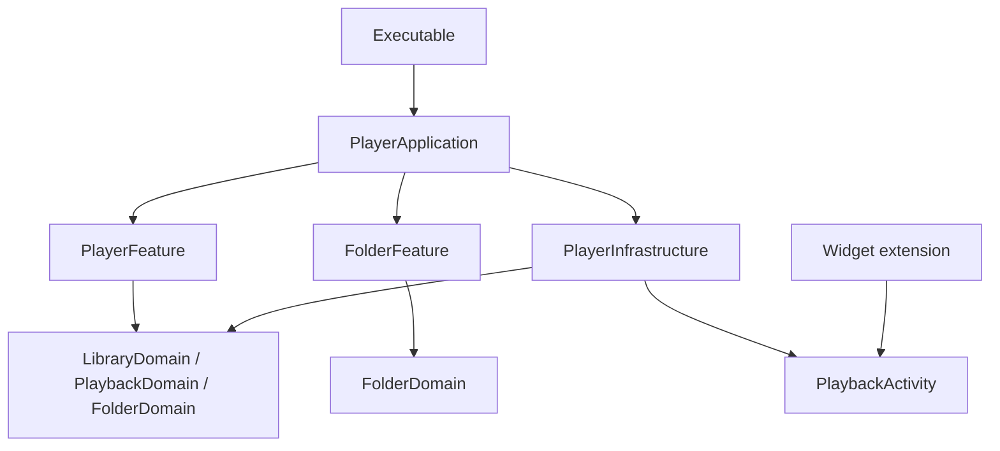

# Разработка и архитектура

*[English](../en/development.md)*

## Открыть проект

В репозитории находятся нативное SwiftUI-приложение, расширение WidgetKit/ActivityKit и локальный SwiftPM-пакет **ATPlayerKit**. Сторонних пакетных зависимостей нет. Исходники включают модули Feature-First и режим «Папки». Используйте выпуск Xcode с SDK, указанным в настройках проекта. Минимальная версия системы — **iOS / iPadOS 26.0**.

```sh
git clone https://github.com/andrey-torlopov/ATPlayer.git
cd ATPlayer
open SRC/ATPlayer/ATPlayer.xcodeproj
```

Выберите общую схему **ATPlayer**, симулятор iPhone или iPad и выполните Run. Приложение поддерживает русский и английский языки; переключатель **RU / EN** расположен вверху настроек. Там же можно выбрать светлую, тёмную или системную тему. По умолчанию используется системная.

Команда сборки для симулятора без подписи из корня репозитория:

```sh
xcodebuild \
  -project SRC/ATPlayer/ATPlayer.xcodeproj \
  -scheme ATPlayer \
  -configuration Debug \
  -destination 'generic/platform=iOS Simulator' \
  -derivedDataPath .build/DerivedData \
  CODE_SIGNING_ALLOWED=NO \
  build
```

Для установки на своё устройство настройте собственную команду разработчика и provisioning **для приложения и расширения**. Bundle identifiers должны быть уникальными в вашем аккаунте; идентификатор расширения должен начинаться с идентификатора приложения. Release-конфигурация в репозитории ссылается на distribution-профили автора; эти профили не предоставляют пользователям репозитория доступ к его аккаунту.

## Карта кода

Локальный пакет находится в `SRC/ATPlayer/LocalPackages/ATPlayerKit/`. Зависимости targets объявлены в `Package.swift`; пути внутри пакета ниже указаны относительно этого каталога.

| Расположение | Ответственность |
|---|---|
| `SRC/ATPlayer/ATPlayer/ATPlayerApp.swift` | Тонкая исполняемая оболочка и время жизни процесса |
| `Sources/PlayerApplication/` | Composition root, конкретные адаптеры, связывание фич, lifecycle и маршрутизация intents |
| `Sources/PlayerFeature/` | Интерфейс плейлистов, состояние плеера и общая очередь; текущий интерфейс — V1 |
| `Sources/FolderFeature/` | Независимые состояние и интерфейс браузера папок, навигация и lifecycle подготовки файлов |
| `Sources/LibraryDomain/`, `Sources/PlaybackDomain/`, `Sources/FolderDomain/` | Доменные модели и контракты без конкретного хранилища и интерфейса фич |
| `Sources/PlayerInfrastructure/` | SwiftData, доступ к файлам, временный кеш, AVAudioEngine, адаптеры Now Playing и Activity |
| `Sources/PlaybackActivity/` | Общие атрибуты ActivityKit для приложения и расширения |
| `Tests/` | Проверки воспроизведения, браузера, хранилища, файлов/кеша и совместимости старой схемы |
| `SRC/ATPlayer/ATPlayerWidgetExtension/` | Отображение Live Activity и точка входа расширения |

`PlayerDesignVersion.current` в `Sources/PlayerFeature/Presentation/` выбирает V1. Представления V0 сохранены для сравнения. Новый интерфейс папок принадлежит `FolderFeature`; UI-фичи не импортируют друг друга и конкретную инфраструктуру.

## Границы модулей и воспроизведение



`PlayerApplication` создаёт конкретные сервисы и связывает типизированный выбор файла из браузера с общим владельцем воспроизведения. Зависимости передаются через доменные контракты. Просмотр библиотеки не управляет активной аудиосессией: переход по папкам не заменяет играющую очередь.

Плейлисты сохраняют исходные имена сущностей и схему SwiftData. Адаптер хранилища преобразует записи в доменные объекты; неудачные изменения откатываются. Корни папок хранятся в `Application Support/ATPlayer/folder-sources.json` и не расширяют базу плейлистов. Списки, навигация и очереди папок остаются в памяти. JSON-экспорт плейлистов исключает папки.

В режиме «Папки» файловый I/O и координированное копирование выполняются вне UI actor. Плеер удерживает lease локальной копии до прекращения чтения движком. Предварительная подготовка последовательна и отменяема; явное воспроизведение имеет приоритет. Временный кеш использует мягкий бюджет 512 МиБ, допускает временное превышение для удерживаемых при смене трека файлов или явно выбранной большой записи и вытесняет неиспользуемые копии. Это не гарантия офлайн-доступа. Импорт папки в плейлист остаётся рекурсивным; просмотр и воспроизведение папок не обходят вложенные уровни.

## Локальное аудио для тестов

Сгенерированные аудиофайлы исключены из Git. Установите FFmpeg и создайте их перед сборкой тестового пакета:

```sh
python3 SRC/ATPlayer/LocalPackages/ATPlayerKit/Tools/generate_audio_fixtures.py
```

Скрипт создаёт короткие синусоидальные сигналы без записанной музыки. См. [инструкцию подготовки](../../SRC/ATPlayer/LocalPackages/ATPlayerKit/Tests/PlayerInfrastructureTests/Fixtures/README.md). Необязательная регрессия с пользовательским MP3 пропускается, если локальная запись отсутствует. Для сборки приложения тестовое аудио не требуется.

## Границы проверки

Пакет содержит `PlayerInfrastructureTests`, `PlayerFeatureTests` и `FolderFeatureTests`, а также отдельный target `LegacyPlaylistFixture`. Откройте `Package.swift` в Xcode и выберите **ATPlayerKit-Package**, чтобы запускать тесты на установленном iOS-симуляторе. Схема приложения остаётся **ATPlayer**. Тесты покрывают открытие старой базы после переноса модуля, границы очередей, отмену и поздние ответы, хранение корней и локальные файловые операции/кеш. Подмены поставщиков и локальные файлы не подтверждают работу реальных iCloud, SMB, сторонних провайдеров, аудиомаршрутов, прерываний и фона; эти сценарии нужно проверить на устройстве, указав модель и ОС.

Перед передачей изменений проверьте добавление файлов, повторный запуск, перемотку, переход между треками, редактирование плейлиста и сворачивание приложения. Дополнительно проверьте смену режима библиотеки во время музыки, очередь текущего уровня, забывание активного корня и подготовку облачных/сетевых файлов. Отдельного внимания требуют недоступные файлы и отмена импорта. См. [проверки релиза](releases.md).

Лицензия открытого исходного кода для репозитория пока не объявлена. Публичная доступность исходников сама по себе не предоставляет лицензию на их использование.

---

[Документация](index.md) · [README](../../README-ru.md)
